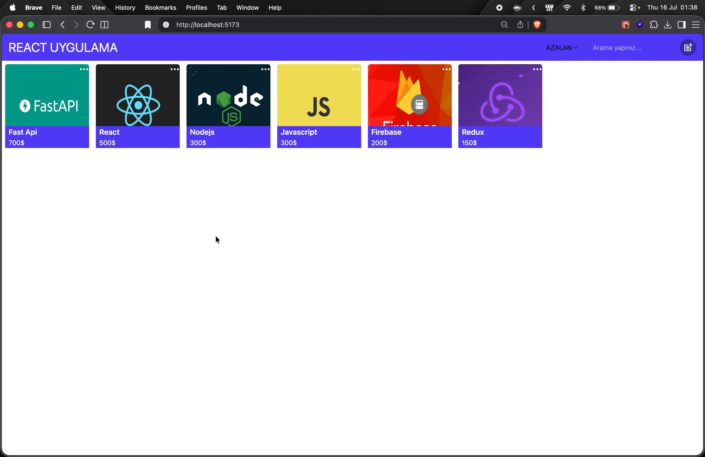

# 🛍️ React + Redux Toolkit Ürün Yönetim Uygulaması

> CRUD işlemlerini Redux Toolkit ile yönetebileceğiniz, modern bir ürün listesi uygulamasıdır.

Bu proje, ürün ekleme, silme, güncelleme, arama ve fiyat sıralama işlemlerini kolayca yapabilmeniz için hazırlanmıştır. Uygulamada state yönetimi için Redux Toolkit kullanılır ve arayüz için React + Tailwind CSS tercih edilmiştir.

## ✨ Özellikler

- ➕ Yeni ürün ekleme
- ✏️ Mevcut ürün güncelleme
- 🗑️ Ürün silme
- 🔎 Ürünlerde arama yapma
- 📈 Fiyatlara göre artan/azalan sıralama
- 🧩 Modal ile form ekranı
- 🖼️ Ürün görseli ekleme desteği
- ⚡ Hızlı ve basit kullanıcı deneyimi

## 🧰 Kullanılan Teknolojiler

- React
- Vite
- Redux Toolkit
- React Router DOM
- Tailwind CSS
- React Icons

## 🧭 Uygulama Akışı

1. Üst kısımda yer alan arama alanı ile ürünleri filtreleyebilirsiniz.
2. Sıralama menüsünden fiyatı artan veya azalan şekilde sıralayabilirsiniz.
3. Sağ üstteki butona tıklayarak ürün ekleme modalını açabilirsiniz.
4. Her ürün kartında silme ve güncelleme işlemleri mevcuttur.
5. Güncelleme işlemi için URL parametresi ile ürün bilgileri tekrar yüklenir.

## 🛠️ State Yönetimi

Uygulama içindeki ürün verileri ve modal durumu Redux Toolkit slice'ları ile yönetilmektedir:

- `dataSlice.js` → ürün ekleme, silme, güncelleme, arama ve sıralama
- `modalSlice.js` → modal açma/kapama durumu
- `store.js` → Redux store yapılandırması

## 👤 Not

Bu proje, Redux Toolkit kullanımını öğrenmek ve CRUD mantığını pratikte görmek için ideal küçük bir örnektir.

## Preview

